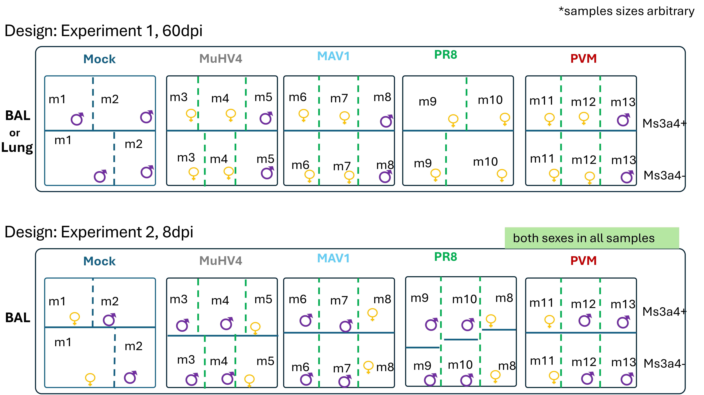
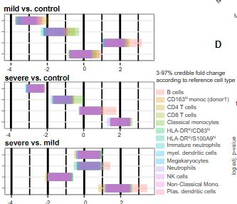

```{r message=FALSE, warning=FALSE}

##| cache: true
easypackages::libraries("viridis","patchwork", "Seurat", "tidyverse","tidyseurat", "ggpubr")

obj.v5 <- read_rds("intermediate_data/seurat_obj_central.rds")
DefaultAssay(obj.v5) <- "RNA"
output_file_path <- "output/final_march2024_joint_analysis/"

# The palette with grey:
cbp1 <- c("#999999", "#E69F00", "#56B4E9", "#009E73",
          "#F0E442", "#0072B2", "#D55E00", "#CC79A7")

# The palette with black:
cbp2 <- c("#000000", "#E69F00", "#56B4E9", "#009E73",
          "#F0E442", "#0072B2", "#D55E00", "#CC79A7")
```

```{r functions, fig.height=12, fig.height=7}

make_zscore_and_freq_data <- function(seurat_tbl){ 
  seurat_tbl |> 
  count(day_mock,sample_type, condition,sample_tag_ms4a3_pos_gabbr2,harmony_cluster_8dims_rough, .drop = FALSE) |> 
  #make columns factors
    mutate(day_mock=factor(day_mock, levels=c("Mock", "d8","d60")),
         sample_type=factor(sample_type, levels= c("lung", "bal")),
         condition=as_factor(condition),
         sampletag_Ms4a3=as_factor(sample_tag_ms4a3_pos_gabbr2),
         harmony_cluster_8dims_rough=as_factor(harmony_cluster_8dims_rough)
         ) |>
  filter(!(day_mock=="Mock"&(condition %in%c("PR8","MuHV4", "PVM", "MAV1")))) |> 
  
  #calculate which proportions of samples are in a given cluster
  group_by(day_mock,sample_type, condition,sample_tag_ms4a3_pos_gabbr2) |>
  mutate(freq_cluster=n/sum(n)) |>

  #calculate zscore of frequencies per cluster
  group_by(harmony_cluster_8dims_rough) |> 
  mutate(cluster_frequency_zscore=(freq_cluster-mean(freq_cluster))/sd(freq_cluster)) }

frequency_heatmap <- function(x){ 
  x |>   ggplot(aes(condition,
                    harmony_cluster_8dims_rough,
                    fill=cluster_frequency_zscore)) +
  geom_tile()+ 
  #scale_fill_viridis()+theme_bw() +
  ggh4x::facet_nested_wrap(
    vars(sample_tag_ms4a3_pos_gabbr2,
         sample_type,
         day_mock),
    nrow = 1,
    drop = TRUE,
    scales = "free_x"#,
    #space="free"
    )+
    theme_bw()+
    theme(axis.text.x = element_text(angle = 45, vjust = 1, hjust=1))+
    scale_fill_gradient2( low = "blue", mid = "white", high = "red")}
```

# Analyses all macrophages:

# Outline

#### 1) Explanation of scientific approach

```         
    a.  Experimental design diagram
    b.  Analytical workflow diagram
```

#### 2) Integrate macrophages of all datasets into a combined embedding (umap)

```         
    a.  Highlight the following groups:
            i.  K-nearest neighbor clusters
            ii. Lung/BAL
            iii.    td+/td-
            iv. mock(d0)/d8/d60
            v.  virus
            vi. virus-Ms4a3-status
            vii. individual samples (virus per time point)
```

#### 3) Compositional analysis

```         
    a.  Stacked bar chart (beware varying base rates)
            i.  Grouping: ???
    b.  Cluster frequency per group
    c.  Z-scores of cluster frequencies: heatmap
    d.  Posterior probability of frequency fold change scCoda
    
```

#### 4) Define clusters by aid of:

```         
    a.  Differential gene expression heatmap
    b.  Heatmap of previously defined signatures 
            i.  Module scores (average logFC of gene set compared to ref.
                    gene set with similar average expression)
    c.  Volcano plots
            i.  Only mock mice: Ms4a3+ vs Ms4a3-
```

# Explanation of scientific approach

## Experimental design

 add mouse diagram

## Analytical workflow

add powerpoint-generated viral_data_analysis_flowchart.pdf -\> readme


# 2) Integrate macrophages of all datasets into a combined embedding (umap)

In the file *case_study_experiment_1_2_integration.qmd* various scenarios of the integration of the data sets were tested. Harmony integration of log normalized counts data was chosen. Umap representation and k-nearest neighbor of the first eight Harmony dimensions was chosen for a noise-reduced analysis and depiction of main effects

## 2a) i. K-nearest neighbor clusters

```{r}
obj.v5 |> DimPlot(group.by = "harmony_cluster_8dims_rough", label=T)

```

## 2a) ii.  Embedding of cells from Lung/Bal

### alpha point

```{r}
obj.v5  |> ggplot(aes(umapharmony8dims_1,umapharmony8dims_2, color=day_sample_type))+
  geom_point(aes(color="cell"))+
  geom_density_2d(bins=20,linewidth=1)+
  scale_color_manual(values = cbp1)+ theme_bw()+
  ggtitle("local density of sample in umap embedding")
```

```{r  fig.width=16, fig.height = 12}
# 1 cond : density by color
obj.v5  |>
  ggplot(aes(umapharmony8dims_1,
             umapharmony8dims_2,
             color=day_sample_type)) +
  geom_point(aes(color="cell")) +
  geom_density_2d(bins=20,linewidth=1) +
  scale_color_manual(values = cbp1 )+
  theme_bw() +
  ggtitle("local density of sample in umap embedding")+
  facet_wrap(~day_sample_type)
```

```{r  fig.width=16, fig.height = 12}
samples <- obj.v5$day_mock_sample_type |> unique()
umap_sampletype_mock_point_plotlist <- list()
for (sample in samples) {
  obj.v5_filtered_for_sample <- obj.v5 |> as_tibble( ) |> filter(day_mock_sample_type==sample)
  obj.v5_not_sample <- obj.v5 |> as_tibble( ) |> filter(day_mock_sample_type!=sample)
  
  umap_sampletype_mock_point_plotlist[[sample]] <- obj.v5 |> 
    ggplot() +
    geom_point(data= obj.v5_not_sample,aes(umapharmony8dims_1,umapharmony8dims_2),color="grey")+
    geom_point(data= obj.v5_filtered_for_sample,aes(umapharmony8dims_1,umapharmony8dims_2),
               color="red",
               alpha=0.4,
               #plot points without outer border without alpha
               stroke = 0,
               shape=16)+
    theme_bw()+
    scale_fill_continuous(type = "viridis")+
    ggtitle(sample)+theme_bw()
}

ggarrange(plotlist = umap_sampletype_mock_point_plotlist)
ggsave(plot= ggarrange(plotlist = umap_sampletype_mock_point_plotlist),path = output_file_path, filename = "umap_sampletype_mock_point_plotlist.svg", width = 20,height = 15)
#only lung or bal -> color:day
```

### umap_sampletype_mock_dens_plotlist

```{r  fig.width=16, fig.height = 12}
samples <- obj.v5$day_mock_sample_type |> unique()
umap_sampletype_mock_dens_plotlist <- list()
for (sample in samples) {
  obj.v5_filtered_for_sample <- obj.v5 |> as_tibble( ) |> filter(day_mock_sample_type==sample)
  umap_sampletype_mock_dens_plotlist[[sample]] <- obj.v5 |> 
    ggplot(aes(umapharmony8dims_1,umapharmony8dims_2) ) +
    geom_point()+
    stat_density_2d(data= obj.v5_filtered_for_sample, 
                    aes(x= umapharmony8dims_1,
                        y=umapharmony8dims_2,
                        fill = after_stat(level)), geom = "polygon",contour_var = "ndensity"
                    )+
    theme_bw()+
    scale_fill_continuous(type = "viridis")+
    ggtitle(sample)+theme_bw()
}

#densities have to be adjusted, overlap
#https://stackoverflow.com/questions/76533721/plot-only-top-layers-of-ggplot-stat-density-2d-geom-density-2d-in-r

ggarrange(plotlist =umap_sampletype_mock_dens_plotlist)

#ggsave(plot= ggarrange(plotlist =umap_sampletype_mock_dens_plotlist ,common.legend = T ),path = output_file_path, filename = "umap_sampletype_mock_dens_plotlist.svg", width = 20,height = 15)

#
```

## 2a) iii. td+/td-

```{r  fig.width=16, fig.height = 7}
samples <- obj.v5$sampletag_Ms4a3 |> unique()
umap_sampletag_Ms4a3_point_plotlist <- list()
for (sample in samples) {
  obj.v5_filtered_for_sample <- obj.v5 |> as_tibble( ) |> filter(sampletag_Ms4a3==sample)
  obj.v5_not_sample <- obj.v5 |> as_tibble( ) |> filter(sampletag_Ms4a3!=sample)
  
  umap_sampletag_Ms4a3_point_plotlist[[sample]] <- obj.v5 |> 
    ggplot() +
    geom_point(data= obj.v5_not_sample,aes(umapharmony8dims_1,umapharmony8dims_2),color="grey")+
    geom_point(data= obj.v5_filtered_for_sample,aes(umapharmony8dims_1,umapharmony8dims_2),
               color="red",
               alpha=0.4,
               #plot points without outer border without alpha
               stroke = 0,
               shape=16)+
    theme_bw()+
    scale_fill_continuous(type = "viridis")+
    ggtitle(sample)+theme_bw()
}

ggarrange(plotlist = umap_sampletag_Ms4a3_point_plotlist)

#ggsave(plot= ggarrange(plotlist = umap_sampletag_Ms4a3_point_plotlist),path = output_file_path, filename = "umap_sampletag_Ms4a3_point_plotlist.svg", width = 20,height = 15)
#only lung or bal -> color:day
```

```{r  fig.width=16, fig.height = 7}
samples <- obj.v5$sampletag_Ms4a3 |> unique()
umap_sampletag_Ms4a3_dens_plotlist <- list()
for (sample in samples) {
  obj.v5_filtered_for_sample <- obj.v5 |> as_tibble( ) |> filter(sampletag_Ms4a3==sample)
  umap_sampletag_Ms4a3_dens_plotlist[[sample]] <- obj.v5 |> 
    ggplot(aes(umapharmony8dims_1,umapharmony8dims_2) ) +
    geom_point()+
    stat_density_2d(data= obj.v5_filtered_for_sample, 
                    aes(x= umapharmony8dims_1,
                        y=umapharmony8dims_2,
                        fill = after_stat(level)), geom = "polygon",contour_var = "ndensity"
                    )+
    theme_bw()+
    scale_fill_continuous(type = "viridis")+
    ggtitle(sample)+theme_bw()
}

#densities have to be adjusted, overlap
#https://stackoverflow.com/questions/76533721/plot-only-top-layers-of-ggplot-stat-density-2d-geom-density-2d-in-r

ggarrange(plotlist =umap_sampletag_Ms4a3_dens_plotlist)

#ggsave(plot= ggarrange(plotlist =umap_sampletag_Ms4a3_dens_plotlist ,common.legend = T ),path = output_file_path, filename = "umap_sampletag_Ms4a3_dens_plotlist.svg", width = 20,height = 15)

```

## 2a) iv. mock(d0)/d8/d60

```{r fig.width=16, fig.height = 12}
samples <- obj.v5$day_mock |> unique()
umap_day_mock_point_plotlist <- list()
for (sample in samples) {
  obj.v5_filtered_for_sample <- obj.v5 |> as_tibble( ) |> filter(day_mock==sample)
  obj.v5_not_sample <- obj.v5 |> as_tibble( ) |> filter(day_mock!=sample)
  
  umap_day_mock_point_plotlist[[sample]] <- obj.v5 |> 
    ggplot() +
    geom_point(data= obj.v5_not_sample,aes(umapharmony8dims_1,umapharmony8dims_2),color="grey")+
    geom_point(data= obj.v5_filtered_for_sample,aes(umapharmony8dims_1,umapharmony8dims_2),
               color="red",
               alpha=0.4,
               #plot points without outer border without alpha
               stroke = 0,
               shape=16)+
    theme_bw()+
    scale_fill_continuous(type = "viridis")+
    ggtitle(sample)+theme_bw()
}

ggarrange(plotlist = umap_day_mock_point_plotlist)

#ggsave(plot= ggarrange(plotlist = umap_day_mock_point_plotlist),path = output_file_path, filename = "umap_day_mock_point_plotlist.svg", width = 20,height = 15)
#only lung or bal -> color:day
```

## 2a) v. virus

```{r fig.width=16, fig.height = 12}

samples <- obj.v5$condition |> unique()
umap_condition_plotlist <- list()
for (sample in samples) {
  obj.v5_filtered_for_sample <- obj.v5 |> as_tibble( ) |> filter(condition==sample)
  obj.v5_not_sample <- obj.v5 |> as_tibble( ) |> filter(condition!=sample)
  
  umap_condition_plotlist[[sample]] <- obj.v5 |> 
    ggplot() +
    geom_point(data= obj.v5_not_sample,aes(umapharmony8dims_1,umapharmony8dims_2),color="grey")+
    geom_point(data= obj.v5_filtered_for_sample,aes(umapharmony8dims_1,umapharmony8dims_2),
               color="red",
               alpha=0.4,
               #plot points without outer border without alpha
               stroke = 0,
               shape=16)+
    theme_bw()+
    scale_fill_continuous(type = "viridis")+
    ggtitle(sample)+theme_bw()
}

ggarrange(plotlist = umap_condition_plotlist)

#ggsave(plot= ggarrange(plotlist = umap_condition_plotlist),path = output_file_path, filename = "umap_condition_plotlist.svg", width = 20,height = 15)
#only lung or bal -> color:day
```

## 2a) vi. virus-Ms4a3-status
```{r fig.width=20, fig.height = 15}
samples <-  obj.v5$sampletag_name |> unique()
umap_sampletag_name_plotlist <- list()
for (sample in samples) {
  obj.v5_filtered_for_sample <- obj.v5 |> as_tibble( ) |> filter(sampletag_name==sample)
  obj.v5_not_sample <- obj.v5 |> as_tibble( ) |> filter(sampletag_name!=sample)
  
  umap_sampletag_name_plotlist[[sample]] <- obj.v5 |> 
    ggplot() +
    geom_point(data= obj.v5_not_sample,
               aes(umapharmony8dims_1,umapharmony8dims_2),
               color="grey")+
    geom_point(data= obj.v5_filtered_for_sample,
               aes(umapharmony8dims_1,umapharmony8dims_2),
               color="red",
               alpha=0.4,
               #plot points without outer border without alpha
               stroke = 0,
               shape=16)+
    theme_bw()+
    scale_fill_continuous(type = "viridis")+
    ggtitle(sample)+theme_bw()
}

ggarrange(plotlist = umap_sampletag_name_plotlist)

#ggsave(plot= ggarrange(plotlist = umap_sampletag_name_plotlist),path = output_file_path, filename = "umap_sampletag_name_plotlist.svg", width = 20,height = 15)

#only lung or bal -> color:day
```

## 2a) vii. individual samples (virus per time point)
```{r fig.width=20, fig.height = 15}
samples <-  obj.v5$day_mock_sample_type_cond_ms4a3|> unique()
umap_sampletag_name_plotlist <- list()
for (sample in samples) {
  obj.v5_filtered_for_sample <- obj.v5 |> as_tibble( ) |> filter(day_mock_sample_type_cond_ms4a3==sample)
  obj.v5_not_sample <- obj.v5 |> as_tibble( ) |> filter(day_mock_sample_type_cond_ms4a3!=sample)
  
  umap_sampletag_name_plotlist[[sample]] <- obj.v5 |> 
    ggplot() +
    geom_point(data= obj.v5_not_sample,
               aes(umapharmony8dims_1,umapharmony8dims_2),
               color="grey")+
    geom_point(data= obj.v5_filtered_for_sample,
               aes(umapharmony8dims_1,umapharmony8dims_2),
               color="red",
               alpha=0.4,
               #plot points without outer border without alpha
               stroke = 0,
               shape=16)+
    theme_bw()+
    scale_fill_continuous(type = "viridis")+
    ggtitle(sample)+theme_bw()
}

ggarrange(plotlist = umap_sampletag_name_plotlist)

#ggsave(plot= ggarrange(plotlist = umap_sampletag_name_plotlist),path = output_file_path, filename = "umap_sampletag_name_plotlist.svg", width = 20,height = 15)

#only lung or bal -> color:day
```

# 3) Compositional analysis

```{r}

obj.v5@misc <-  read_rds("intermediate_data/exp1_exp2_misc_list.rds") #can be deleted later
x_axis_text_90 <-  theme(axis.text.x = element_text(angle = 90))
```

```{r}
prefiltering_data<- bind_rows(
obj.v5@misc[[1]][[1]][[2]] |> mutate(dataset="d60_lung", orig.ident="viral.experiment.1__lung",exp="exp_1_lung_") ,
obj.v5@misc[[1]][[2]][[2]] |> mutate(dataset="d60_bal", orig.ident="viral.experiment.1__bal",exp="exp_1_bal_"),
obj.v5@misc[[2]][[1]][[2]] |> mutate(dataset="d8_lung", orig.ident="viral.experiment.2__lung",exp="exp_2_lung_"),
obj.v5@misc[[2]][[2]][[2]] |> mutate(dataset="d8_bal", orig.ident="viral.experiment.2__bal",exp="exp_2_bal_")) |>
  
  mutate(cell_id_comb=paste0( exp,.cell)) |>
  relocate(cell_id_comb)

obj_tbl <- tibble(cell_id_comb=colnames(obj.v5),
       orig.ident= obj.v5$orig.ident,
       sampletag_Ms4a3=obj.v5$sampletag_Ms4a3 )## |>
        #mutate(.cell=str_remove_all(.cell, "[abcdefghijklmnopqrstuvwxyz_]"))
               
tab2 <-  obj.v5 |> as_tibble() |>
        mutate(cell_id_comb=.cell) |> 
        right_join(prefiltering_data,
                   by = c("cell_id_comb" #,"orig.ident"
                                             ))
```

### 3a) freq of live single cells-gabbr2 corrected

```{r}
#| fig-width: 12
freq_harmony_rough_clusters_of_live_single_live_cells_gabbr2_corrected  <- tab2 |>
        filter(is_single_live_cell=="is_single_live_cell") |>
        #filter(!is.na(dataset) , !is.na(sample_tag_ms4a3_pos_gabbr2), !is.na(harmony_cluster_8dims_rough)) |> #do we need this??
        mutate(harmony_cluster_8dims_rough_group = paste(harmony_cluster_8dims_rough,
                                                         sample_tag_ms4a3_pos_gabbr2)) |> 
        group_by(dataset,
                 sampletag_name,
                 sample_tag_ms4a3_pos_gabbr2) |>
        count(harmony_cluster_8dims_rough_group) |> 
        group_by(dataset,sampletag_name) |> 
        mutate(dataset_sampletag=paste(dataset,sampletag_name, sep="_")) |> 
        mutate(freq=n/sum(n))
        
```

```{r}
##
freq_harmony_rough_clusters_of_live_single_live_cells_gabbr2_corrected |>
        ggplot(aes(dataset_sampletag,
                   freq,
                   fill=sample_tag_ms4a3_pos_gabbr2)) + 
  geom_bar(stat = "identity")+
  x_axis_text_90 +ggtitle("freqeucnies of single live cells")

###
freq_harmony_rough_clusters_of_live_single_live_cells_gabbr2_corrected |>
  separate(harmony_cluster_8dims_rough_group, into = "cluster") |> 
        filter(sample_tag_ms4a3_pos_gabbr2!="Gabbr2_pos_Ms4a3_neg") |> 
        ggplot(aes(dataset_sampletag,
                   freq,
                   fill=cluster)) + 
  geom_bar(stat = "identity")+ x_axis_text_90 +
        ggtitle("freqeucnies of single live cells")

# scaled to 1
freq_harmony_rough_clusters_of_live_single_live_cells_gabbr2_corrected |>
  separate(harmony_cluster_8dims_rough_group, into = "cluster") |> 
        filter(sample_tag_ms4a3_pos_gabbr2!="Gabbr2_pos_Ms4a3_neg") |> 
          group_by(dataset,sampletag_name) |> 
        mutate(freq=n/sum(n)) |> 
        ggplot(aes(dataset_sampletag,
                   freq,
                   fill=cluster)) + 
  geom_bar(stat = "identity")+ x_axis_text_90
```


## 3b) cluster frequencies per group

```{r fig.width=15, fig.height = 5}
#group frequencies with Ms4a3 correction

p1 <- obj.v5 |>  as_tibble()  |> filter(sample_tag_ms4a3_pos_gabbr2!= "Gabbr2_pos_Ms4a3_neg") |>  make_zscore_and_freq_data() |>
  mutate(individual_sample=paste(day_mock,
                                 sample_type,
                                 condition,
                                 sample_tag_ms4a3_pos_gabbr2,
                                 sep = "_")) |> 
  ggplot(aes(individual_sample,freq_cluster,color=condition)) + geom_point()+ facet_wrap(~harmony_cluster_8dims_rough, scales = "free", nrow=1) +theme(axis.text.x = element_blank(), axis.title = element_blank())

p2 <- obj.v5 |>  as_tibble()  |> filter(sample_tag_ms4a3_pos_gabbr2!= "Gabbr2_pos_Ms4a3_neg") |>  make_zscore_and_freq_data() |>
  mutate(individual_sample=paste(day_mock,sample_type, condition,sample_tag_ms4a3_pos_gabbr2, sep = "_")) |> 
  ggplot(aes(individual_sample,freq_cluster,color=day_mock)) + geom_point()+ facet_wrap(~harmony_cluster_8dims_rough, scales = "free", nrow=1)+ theme(axis.text.x = element_blank(), axis.title = element_blank())

p3 <- obj.v5 |>  as_tibble()  |> filter(sample_tag_ms4a3_pos_gabbr2!= "Gabbr2_pos_Ms4a3_neg") |>  make_zscore_and_freq_data() |>
  mutate(individual_sample=paste(day_mock,sample_type, condition,sample_tag_ms4a3_pos_gabbr2, sep = "_")) |> 
  ggplot(aes(individual_sample,freq_cluster,color=sample_type)) + geom_point()+ facet_wrap(~harmony_cluster_8dims_rough, scales = "free", nrow=1) +theme(axis.text.x = element_blank(), axis.title = element_blank())

p4 <- obj.v5 |>  as_tibble()  |> filter(sample_tag_ms4a3_pos_gabbr2!= "Gabbr2_pos_Ms4a3_neg") |>  make_zscore_and_freq_data() |>
  mutate(individual_sample=paste(day_mock,sample_type, condition,sample_tag_ms4a3_pos_gabbr2, sep = "_")) |> 
  ggplot(aes(individual_sample,freq_cluster,color=sample_tag_ms4a3_pos_gabbr2)) + geom_point()+ facet_wrap(~harmony_cluster_8dims_rough, scales = "free", nrow=1, strip.position="bottom") + scale_color_brewer(palette = "Set2")+ #x_axis_text_90+
   theme_classic()+
  theme(axis.text.x = element_blank(), axis.title = element_blank())

(p1 + theme(strip.text.x = element_blank()))/
  (p2+theme(strip.text.x = element_blank()))/
  (p3+theme(strip.text.x = element_blank()))/
  p4 +
  plot_layout(guides = 'collect')
```

## 3c Z-scores of cluster frequencies: heatmap

```{r }
#| fig-asp: 0.3
#| fig-width: 12

obj.v5 |>  as_tibble() |>
  separate(orig.ident, sep = "__", into = c("day", "sample_type"), remove = FALSE) |> 
    mutate(day=str_replace_all(day,c("viral.experiment.1"="d60",
                                                 "viral.experiment.2"="d8") )) |>
  mutate(day=ifelse(condition=="Mock",condition,day)) |> 
    mutate(day=factor(day, levels=c("Mock", "d8","d60")),
         sample_type=as_factor(sample_type),
         condition=as_factor(condition),
         sampletag_Ms4a3=as_factor(sampletag_Ms4a3),
         harmony_cluster_8dims_rough=as_factor(harmony_cluster_8dims_rough)
         ) |> 
  group_by(day,sample_type, condition,sampletag_Ms4a3,harmony_cluster_8dims_rough) |>
  count(day,sample_type, condition,sampletag_Ms4a3,harmony_cluster_8dims_rough, .drop = FALSE) |> 
  mutate(sample=paste(day,sample_type,condition,sampletag_Ms4a3)) |> 
  group_by(sample) |>
 
  filter(!(day=="Mock"&(condition %in%c("PR8","MuHV4", "PVM", "MAV1")))) |> 
    mutate(freq_cluster=n/sum(n)) |>
  mutate(condition=as.character(condition)) |> na.omit() |> 
  group_by(harmony_cluster_8dims_rough) |> 
  mutate(cluster_mean_freq=mean(freq_cluster)) |> 
  
 # filter(harmony_cluster_8dims_rough %in% c(7,8,9,10)) |> 
  mutate(cluster_mean_freq_zscore=(freq_cluster-cluster_mean_freq)/sd(freq_cluster)) |> 

  ggplot(aes(condition,harmony_cluster_8dims_rough, fill=cluster_mean_freq_zscore)) +
  geom_tile()+ 
  #scale_fill_viridis()+theme_bw() +
  ggh4x::facet_nested_wrap(
    vars(sampletag_Ms4a3,sample_type ,day), nrow = 1,drop = TRUE,scales = "free_x"
  )+theme_bw()+ theme(axis.text.x = element_text(angle = 45, vjust = 1, hjust=1))   + scale_fill_gradient2(  low = "blue",
  mid = "white",
  high = "red")+ggtitle("proportions of cells from a given sample distributed across clusters ",
                        "Ms4a3 classification as sorted")
```

## 3d) Option: Posterior probability of frequency fold change scCoda





#### 4) Define clusters by aid of:
      
    a.  Differential gene expression heatmap
    b.  Heatmap of previously defined signatures 
            i.  Module scores (average logFC of gene set compared to ref.
                    gene set with similar average expression)
    c.  Volcano plots
            i.  Only mock mice: Ms4a3+ vs Ms4a3-
